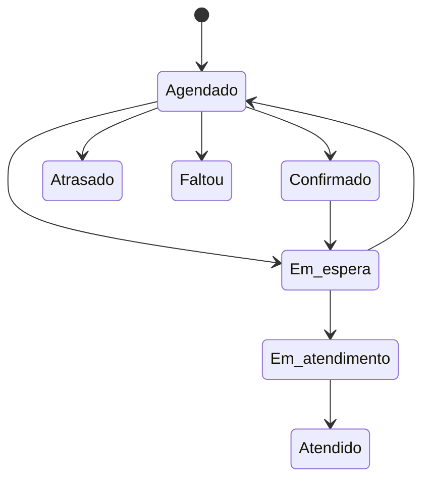

# E-002 Agendamento (consulta ou compromisso)
Product term: Consulta / Agendamento / Compromisso · Parent: E-006 · Status: draft

## Fields

| Field | Type | Required | Default | Constraints or enum | Source |
|---|---|---|---|---|---|
| id | number | sim | | | [net EV-014] |
| date | iso-date | sim | | dia | [net EV-014] |
| AtomicDate | number | sim | | dia como número | [net EV-014] |
| fromTime, toTime | string | sim | | "17:00"–"17:15" | [net EV-014] [obs EV-015] |
| Clinic_BusinessId | number | sim | | → E-006 | [net EV-014] |
| Dentist_PersonId | number | sim | | → E-001 (DENTIST) | [net EV-014] |
| Patient_PersonId | number | sim (consulta) | | → E-001 (PATIENT) | [net EV-014] |
| Name, PatientName, Email, MobilePhone | string | | | cópia de dados do paciente | [net EV-014] |
| ScheduleToId, ScheduleToType | number/string | sim | | agenda de quem | [net EV-014] |
| Type | enum | | | ASSIGN observado | [net EV-003] |
| CategoryId, CategoryColor, CategoryDescription | number/hex/string | não | | categorias: Avaliação, Cirurgia, Consulta, Ortopedia, Periódico, Retorno (da conta) | [net EV-014] |
| Notes | string | não | | observações | [net EV-014] |
| Procedures, SelectedProceduresList, ProceduresDuration | string/array/number | não | | duração vinda dos procedimentos | [net EV-014] |
| isNew | string | não | | "Primeira consulta" | [net EV-014] |
| AlertInfo | object | sim | | Confirm*/Alert* × Schedule, CliniMe, Whats, Sms, Email, Agents | [net EV-014] |
| StatusId, StatusDescription | number/string | | | → E-007 | [net EV-016] |
| CheckinTime, WaitStart, WaitEnds | epoch-ms | não | | check-in e espera | [net EV-016] |
| Waiting, CheckinUsedIn | string | não | | "Confirmado pela secretária" | [net EV-016] [obs EV-019] |
| Deleted | string | | | exclusão lógica | [net EV-014] |
| CreatedBy, CreateUserId, CreateDate | string/number/iso-date | sim | | "Agendado por … em …" | [net EV-014] [obs EV-015] |
| ListTagsId, tags | array | não | | marcadores | [net EV-014] |
| AddInfo | object | não | | | [net EV-014] |
| z_Inserted_Date, z_LastChange_Date | iso-date | sim | | auditoria em todo registro | [net EV-004] |
| z_Inserted_UserId, z_LastChange_UserId | number | sim | | usuário | [net EV-004] |
| z_Inserted_Server_Tool, z_LastChange_Server_Tool, z_*_FingerPrintId | string/number | sim | | origem da escrita | [net EV-004] |

## Relations

| Relation | Target | Cardinality | On delete | Source |
|---|---|---|---|---|
| paciente | E-001 | N:1 | | [net EV-014] |
| dentista | E-001 | N:1 | | [net EV-014] |
| status | E-007 | N:1 | | [net EV-016] |

## Lifecycle

Transições observadas: Agendado→Em espera→Agendado [net EV-016] [obs EV-019]. As demais setas são as opções do seletor, sem restrição testada.

## System fields

| Field | Set when | Source |
|---|---|---|
| CheckinTime, WaitStart | status "Em espera" | [net EV-016] |

## Rules

- R-021, R-023, R-027, R-029, R-030, R-031, R-033, R-034, R-035

## Not tested

- Desmarcação (motivo), lista de espera, recorrência, sobreposição de horários (isDouble).