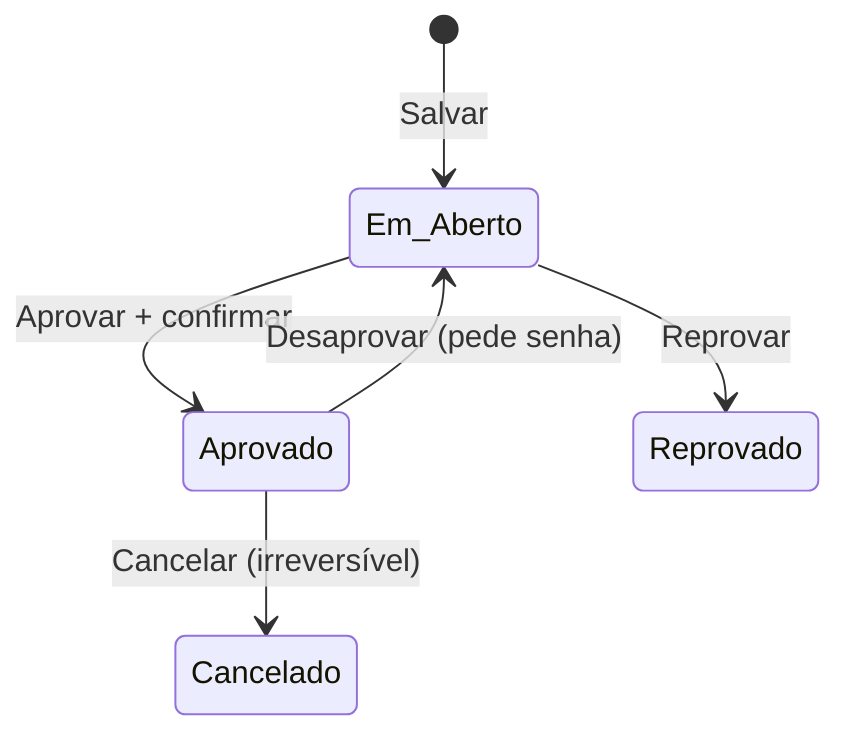

# E-003 Tratamento / Orçamento
Product term: Orçamento (IsEstimate) que vira Tratamento ao aprovar · Parent: E-001 · Status: draft

## Fields

| Field | Type | Required | Default | Constraints or enum | Source |
|---|---|---|---|---|---|
| id | number | sim | | | [net EV-008] |
| Patient_PersonId | number | sim | | → E-001 | [net EV-008] |
| Dentist_PersonId | number | sim | | "Orçamento criado por" | [net EV-008] |
| BusinessId | number | sim | | → E-006 | [net EV-008] |
| IsEstimate | string | sim | | orçamento vs tratamento | [net EV-008] |
| Status | enum | sim | OPEN | OPEN ("Em Aberto"), APPROVED ("Aprovado"); Cancelado na UI | [net EV-008, EV-006] [obs EV-020] |
| CreateDate, CreateDateAtomic | iso-date/number | sim | | | [net EV-008] |
| ApprovedDate, ApprovedDateAtomic, ApprovedByUserId, ApprovedByUserName | | na aprovação | | | [net EV-013] |
| PaymentTypePlan, PaymentFormDescription | string | | | "Dinheiro, À vista" | [net EV-013] |
| CurrentEstimatePaymentPlanId, CurrentChargePaymentPlanId | number | | | → E-005 | [net EV-008, EV-013] |
| EstimateVersion | number | | | versão do orçamento | [net EV-008] |
| ValidUntil | iso-date | não | null | validade | [net EV-008] |
| Notes | string | não | | até 11.320 caracteres na UI | [net EV-013] [obs EV-009] |
| z_Inserted_Date, z_LastChange_Date | iso-date | sim | | auditoria em todo registro | [net EV-004] |
| z_Inserted_UserId, z_LastChange_UserId | number | sim | | usuário | [net EV-004] |
| z_Inserted_Server_Tool, z_LastChange_Server_Tool, z_*_FingerPrintId | string/number | sim | | origem da escrita | [net EV-004] |

## Relations

| Relation | Target | Cardinality | On delete | Source |
|---|---|---|---|---|
| itens | E-004 | 1:N | cancela junto (R-036) | [net EV-013] [obs EV-020] |
| planos de pagamento | E-005 | 1:N | parcelas canceladas (R-036) | [net EV-013] |

## Lifecycle

Observado: Em Aberto → Aprovado [net EV-013]. Desaprovar, Cancelar e Reprovar foram vistos como opções, não executados [obs EV-020, EV-021].

## System fields

| Field | Set when | Source |
|---|---|---|
| ApprovedBy*, ApprovedDate | aprovação | [net EV-013] |

## Rules

- R-010, R-011, R-017, R-018, R-019, R-026, R-036, R-037, R-038

## Not tested

- Reprovar, validade, descontos, versão > 1, contrato.